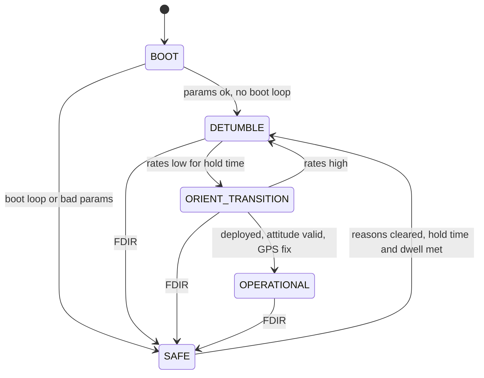
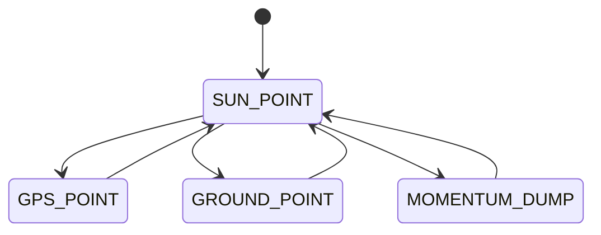
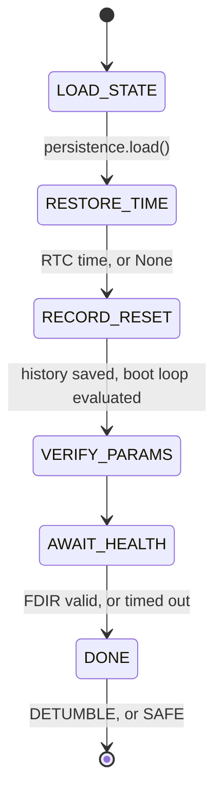
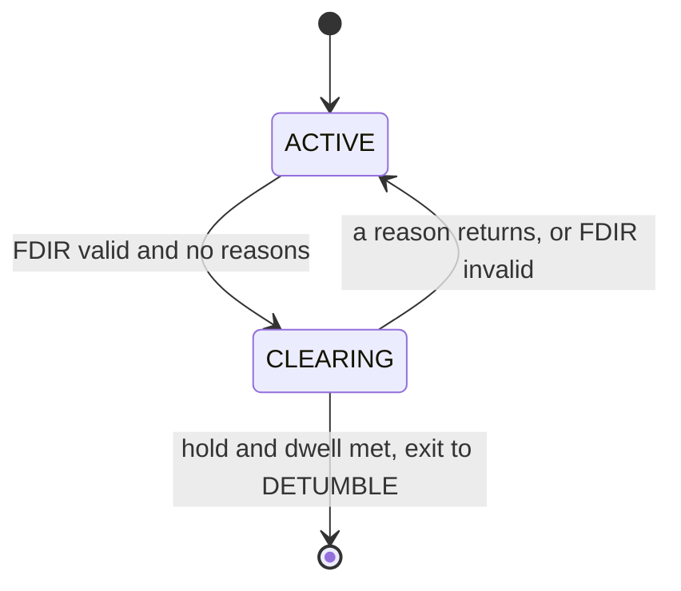

# State flow

Every state machine in the executive, drawn from the transition tables in code.
Each diagram sits under a marker naming the table it documents.
`tests/unit/executive/test_state_flow_doc.py` fails if a diagram and its table
disagree, so change both together. Only edges (`A --> B`) are checked; labels
are free text.

Modes are the top-level states. Sub-modes, BOOT steps and SAFE phases are
separate machines that run *inside* one mode. See `conventions.md` for why we
say "mode" and not "state".

## Modes

FDIR (Fault Detection, Isolation, and Recovery) can force SAFE from any mode, and SAFE only leaves through DETUMBLE.
Every boot enters DETUMBLE, never "where we left off".

<!-- table: cloversat.executive.state_manager.MODE_TRANSITIONS -->

## OPERATIONAL sub-modes

SUN_POINT is home. The others preempt it and always return to it, never to each
other. How `OperationalMode` chooses is OQ-6.

<!-- table: cloversat.executive.state_manager.SUBMODE_TRANSITIONS -->

## BOOT steps

Steps that don't wait run back to back inside one tick. Only AWAIT_HEALTH
waits: for FDIR's first valid flags, or `boot_health_wait_s`, whichever is first.

<!-- table: cloversat.executive.boot_mode.BOOT_STEP_TRANSITIONS -->

## SAFE phases

The exit needs CLEARING for `safe_clear_hold_s` and `safe_min_dwell_s` in SAFE.
A reason returning during CLEARING discards the hold timer. Sun-seek vs passive
is not a state; it is recomputed every tick from what is usable.

<!-- table: cloversat.executive.safe_mode.SAFE_PHASE_TRANSITIONS -->

## SAFE reasons (`SafeReason`)

LOW_POWER, BOOT_LOOP, SUBSYSTEM_RECOVERY, CRITICAL_FAULT, ESTIMATOR_INVALID,
PARAMS_INVALID. FDIR raises them. BOOT_LOOP and PARAMS_INVALID are pure
functions of persisted history and params, so FDIR re-evaluates them every tick
and they clear on their own.

## Handler faults

Not a separate machine: it uses the SAFE edges above. If any handler call raises
(a bad param, a bug, a command for the wrong mode, an illegal `next_mode`
answer), `StateManager` records a `HandlerFault` and moves that mode to SAFE with
the reason `handler fault: <where>`. If SAFE itself raises, the tick returns a
bare SAFE command (no target) and the fault is recorded. `consecutive_fault_ticks`
tells `main.py` when to stop trusting the loop and let the watchdog reset.
Afterwards SAFE exits the normal way, so a persistent fault retries about once
per dwell period instead of locking up.
